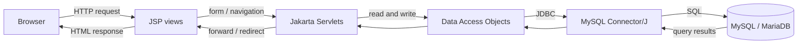

# Blinkit Replica — Java Web Application

A student project that demonstrates a grocery shopping workflow with Java Servlets, JSP, JDBC, and MySQL. Browse and search a product catalogue, manage a session-based cart, and place an order with inventory checks.

> This is an educational local demo, not a production-ready shopping or payment system.

## Project objectives

- Demonstrate a Java web application using the Servlet/JSP model.
- Separate request handling, business/data access, and presentation concerns.
- Read catalogue data from MySQL through JDBC.
- Demonstrate session-based cart operations and transactional order placement.
- Package and deploy a web application with Maven and Apache Tomcat.

## Features

- Product catalogue backed by MySQL, with name/description search and category filtering.
- Add products to a session cart; update quantities, remove items, or clear the cart.
- Checkout with customer name and delivery address.
- Persist orders and order items in a JDBC transaction.
- Check stock and decrement inventory when an order is successfully placed.
- Sample categories and products in the database initialization script.

## Technology stack

| Area | Technology |
|---|---|
| Language | Java 25 |
| Web UI | JSP, HTML, CSS |
| Request handling | Jakarta Servlets 6 |
| Data access | JDBC, MySQL Connector/J |
| Database | MySQL or compatible MariaDB |
| Build and packaging | Maven; WAR packaging |
| Servlet container | Apache Tomcat 10.1 |

## Architecture



JSP pages render the user interface. Servlets handle HTTP requests and coordinate application work, while the DAO classes perform database operations through JDBC. `Product` and `CartItem` are model classes. The shopping cart is kept in the user's HTTP session; orders and inventory are stored in MySQL.

**Maven** resolves dependencies, compiles the Java source, and packages the deployable WAR. **Apache Tomcat 10.1** runs the web application and provides the Jakarta Servlet/JSP runtime; the Servlet API is supplied by Tomcat rather than bundled as an application dependency.

## Project structure

```text
.
├── database/
│   └── blinkit_replica.sql       # Database schema and sample data
├── src/
│   └── main/
│       ├── java/com/blinkit/
│       │   ├── dao/              # Product and order database access
│       │   ├── model/            # Product and cart item models
│       │   ├── servlet/          # HTTP request handlers
│       │   └── util/             # JDBC connection utility
│       └── webapp/
│           ├── WEB-INF/web.xml   # Web application descriptor
│           ├── css/style.css
│           └── *.jsp             # Application views
├── screenshots/                  # Optional project screenshots
├── pom.xml                       # Maven build configuration
└── README.md
```

The `target/` directory is generated by Maven and is intentionally excluded from Git.

### Application entry point and servlet routes

This web application has no Java `main` method. Tomcat starts the application from the WAR, and `index.jsp` is the welcome page configured in `WEB-INF/web.xml`. Servlet routes are declared with `@WebServlet`:

| Route | Servlet | Purpose |
|---|---|---|
| `/products` | `ProductServlet` | Load, search, and filter products |
| `/cart` | `CartServlet` | Display and update the session cart |
| `/checkout` | `CheckoutServlet` | Validate checkout and place an order |
| `/order-success` | `OrderSuccessServlet` | Display the completed order |

## Database

`database/blinkit_replica.sql` creates the `blinkit_replica` database, its tables, and sample catalogue data.

| Table | Description |
|---|---|
| `categories` | Unique product category names |
| `products` | Product details, category, price, stock, and image URL |
| `orders` | Customer, delivery address, total, status, and creation time |
| `order_items` | Product and quantity snapshots associated with an order |

### MySQL connection configuration

For the local XAMPP demo, the existing `DBConnection` class uses `localhost:3306`, database `blinkit_replica`, username `root`, and an empty password. These are sample local-development settings only, not production credentials. If your local MySQL setup differs, update the connection constants in `src/main/java/com/blinkit/util/DBConnection.java` for your own machine and do not commit real passwords.

The application currently keeps these settings in source code. For a deployed or shared environment, use a least-privilege database account and move credentials to a server-side environment/configuration mechanism (for example, a Tomcat-managed JNDI DataSource). Do not put credentials in Git, JSPs, or browser code.

## Prerequisites

- JDK 25 and `JAVA_HOME` configured.
- Maven 3.9 or later.
- MySQL or MariaDB (XAMPP is suitable for local development).
- Apache Tomcat 10.1.x.
- A browser. VS Code with the Extension Pack for Java is optional.

Tomcat 10.1 requires Java 11 or later; this project's Maven compiler release is configured for Java 25.

## Build with Maven

From the directory containing `pom.xml`:

```bash
mvn clean package
```

The generated WAR is `target/blinkit-replica.war`.

## Set up the database

1. Start MySQL in XAMPP (Apache in XAMPP is not required).
2. Create and populate the database by importing `database/blinkit_replica.sql` with phpMyAdmin, MySQL Workbench, or the MySQL command-line client. For example:

   ```bash
   mysql -u root -p < database/blinkit_replica.sql
   ```

   If your local root account has no password, omit `-p`. Adjust the command for your local database installation.
3. Confirm that the `blinkit_replica` database contains `categories`, `products`, `orders`, and `order_items`.
4. Ensure the JDBC settings in `DBConnection.java` match your local database.

The SQL script inserts its sample categories and avoids adding a product again when a product with the same name already exists.

## Deploy to Tomcat 10.1

1. Build the WAR with `mvn clean package`.
2. Copy `target/blinkit-replica.war` into Tomcat's `webapps` directory.
3. Start Tomcat (on Windows, run `bin\startup.bat`; to keep logs in the terminal, run `bin\catalina.bat run`).
4. Visit **http://localhost:8080/blinkit-replica/**.
5. To stop Tomcat on Windows, run `bin\shutdown.bat`.

The application uses Jakarta Servlet APIs and is configured for Tomcat 10.1; it is not directly compatible with Tomcat 9 without migration.

## Screenshots

Add screenshots to a `screenshots/` directory and link them here. No screenshots are included yet.

<!-- Example:  -->

## Team contributions

Replace the placeholders with the project team's names and contributions.

| Team member | Contribution |
|---|---|
| Member 1 — _Name_ | _Contribution_ |
| Member 2 — _Name_ | _Contribution_ |
| Member 3 — _Name_ | _Contribution_ |
| Member 4 — _Name_ | _Contribution_ |
| Member 5 — _Name_ | _Contribution_ |
| Member 6 — _Name_ | _Contribution_ |

## Limitations and future enhancements

- Educational demo; no user accounts, authentication, or authorization.
- No real payment processing, delivery tracking, or production deployment configuration.
- Database connection values are local-development constants in source code.
- The UI and sample data are intended for demonstration rather than a production catalogue.

Possible enhancements include externalized secrets and a managed connection pool, user accounts and role-based access, automated tests, improved input/CSRF protections, payment-provider integration, delivery tracking, and deployment automation.
