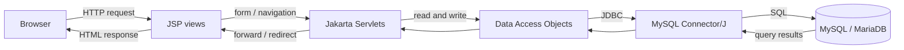

# QuickCart — Java Web Application

A grocery shopping application built with Java Servlets, JSP, JDBC, and MySQL. Browse and search a product catalogue, manage a session-based cart, and place an order with inventory checks.

> This is an educational local demo, not a production-ready shopping or payment system.

## Project objectives

- Demonstrate a Java web application using the Servlet/JSP model.
- Separate request handling, business/data access, and presentation concerns.
- Read catalogue data from MySQL through JDBC.
- Demonstrate session-based cart operations and transactional order placement.
- Package and deploy a web application with Maven and Apache Tomcat.

## Features

- Product catalogue backed by MySQL, with name/description search and category filtering.
- Add products to a session cart; update quantities, remove items, or clear the cart.
- Checkout with customer name and delivery address.
- Persist orders and order items in a JDBC transaction.
- Check stock and decrement inventory when an order is successfully placed.
- Add selected products from the React-powered frequently purchased section to the real cart.
- Provide separate administrator sign-in for inventory management, order lists, order history, and popular-product sales rankings.
- Sample categories and products in the database initialization script.

## Technology stack

| Area | Technology |
|---|---|
| Language | Java 25 |
| Web UI | JSP, HTML, CSS, React 18 enhancements |
| Request handling | Jakarta Servlets 6 |
| Data access | JDBC, MySQL Connector/J |
| Database | MySQL or compatible MariaDB |
| Build and packaging | Maven; WAR packaging |
| Servlet container | Apache Tomcat 10.1 |

## Architecture



JSP pages render the user interface. Servlets handle HTTP requests and coordinate application work, while the DAO classes perform database operations through JDBC. Product, cart, order, and popular-product models carry data between layers. The shopping cart is kept in the user's HTTP session; orders and inventory are stored in MySQL.

**Maven** resolves dependencies, compiles the Java source, and packages the deployable WAR. **Apache Tomcat 10.1** runs the web application and provides the Jakarta Servlet/JSP runtime; the Servlet API is supplied by Tomcat rather than bundled as an application dependency.

## Project structure

```text
.
├── database/
│   └── blinkit_replica.sql       # Database schema and sample data
├── src/
│   └── main/
│       ├── java/com/blinkit/
│       │   ├── dao/              # Product, admin, user, and order database access
│       │   ├── model/            # Product, cart, and order models
│       │   ├── servlet/          # Customer and administrator request handlers
│       │   ├── filter/           # Authentication, CSRF, JSP, and response-header filters
│       │   └── util/             # JDBC connection, password, CSRF, and session utilities
│       └── webapp/
│           ├── WEB-INF/web.xml   # Web application descriptor
│           ├── css/style.css
│           └── *.jsp             # Application views
├── screenshots/                  # Optional project screenshots
├── .env.example                  # Placeholder environment configuration
├── pom.xml                       # Maven build configuration
└── README.md
```

The `target/` directory is generated by Maven and is intentionally excluded from Git.

### Application entry point and servlet routes

The web application is deployed as a WAR and has no runtime application `main` method. Tomcat starts it, and `index.jsp` is the welcome page configured in `WEB-INF/web.xml`. `AdminCredentialTool` is a separate command-line utility for generating admin password hashes. Servlet routes are declared with `@WebServlet`:

| Route | Servlet | Purpose |
|---|---|---|
| `/products` | `ProductServlet` | Load, search, and filter products |
| `/cart` | `CartServlet` | Display and update the session cart |
| `/checkout` | `CheckoutServlet` | Validate checkout and place an order |
| `/order-success` | `OrderSuccessServlet` | Display the completed order |
| `/admin/login` | `AdminAuthServlet` | Separate administrator sign-in |
| `/admin/dashboard` | `AdminServlet` | Admin overview and recent orders |
| `/admin/inventory` | `AdminServlet` | View and update product stock |
| `/admin/orders` | `AdminServlet` | Recent order list |
| `/admin/order-history` | `AdminServlet` | All historical orders and item details |
| `/admin/popular-items` | `AdminServlet` | Products ranked by units sold |

## Database

`database/blinkit_replica.sql` creates the `blinkit_replica` database, its tables, and sample catalogue data.

| Table | Description |
|---|---|
| `users` | Registered customer accounts, contact details, and BCrypt password hashes |
| `admin_users` | Privately provisioned admin accounts with PBKDF2 password hashes |
| `categories` | Unique product category names |
| `products` | Product details, category, price, stock, and image URL |
| `orders` | Customer, delivery address, total, status, and creation time |
| `order_items` | Product and quantity snapshots associated with an order |

### Database and runtime configuration

The application reads `DB_URL`, `DB_USER`, and `DB_PASSWORD` from the process environment; startup/database access fails if any are missing. Copy `.env.example` only as a reference: Java and Tomcat do **not** load `.env` files automatically. Configure variables in the Tomcat service environment or `setenv.bat`, and never commit real credentials.

For local development, use a dedicated MySQL account rather than `root`. After creating/importing the database with an administrative account, grant the application only the operations it needs:

```sql
CREATE USER 'quickcart_app'@'localhost' IDENTIFIED BY 'REPLACE_WITH_A_LOCAL_SECRET';
GRANT SELECT, INSERT, UPDATE, DELETE ON blinkit_replica.* TO 'quickcart_app'@'localhost';
```

Set `DB_URL` to `jdbc:mysql://localhost:3306/blinkit_replica?sslMode=DISABLED` for a local-only MySQL instance. For a remote database, use `sslMode=VERIFY_IDENTITY` with a trusted server certificate; remote non-TLS connections and `allowPublicKeyRetrieval=true` are rejected. Keep the username and password in their separate environment variables, not in the JDBC URL.

Other supported settings:

| Variable | Default | Purpose |
|---|---:|---|
| `BCRYPT_COST` | `12` | Customer BCrypt work factor; accepted range 10–16 |
| `SESSION_COOKIE_SECURE` | Container default | Set `true` behind HTTPS; leave false for local HTTP |
| `HSTS_ENABLED` | `false` | Emit HSTS only when enabled and the request is HTTPS |
| `LOGIN_MAX_FAILURES` | `5` | Failures before temporary IP-based throttling; range 3–20 |
| `LOGIN_WINDOW_SECONDS` | `300` | Failure counting window; range 30–3600 |
| `LOGIN_LOCK_SECONDS` | `60` | Initial throttle; range 30–600 |
| `LOGIN_MAX_LOCK_SECONDS` | `900` | Maximum progressive throttle; range 60–3600 |

The login limiter is in-memory and per application instance. Behind a reverse proxy, configure Tomcat's trusted proxy handling so `getRemoteAddr()` reflects the actual client. Multi-instance deployments need a shared rate-limiting store. Tomcat sets the session cookie `HttpOnly` and `SameSite=Lax`; session timeout is 30 minutes. Enable `SESSION_COOKIE_SECURE=true` only when the browser reaches the application over HTTPS.

Customer state-changing forms and requests use session CSRF tokens. Admin operations retain their CSRF checks. Authenticated/dynamic responses receive `no-store`; CSP, frame, MIME-sniffing, and referrer headers are also set. HSTS is intentionally opt-in.

## Prerequisites

- JDK 25 and `JAVA_HOME` configured.
- Maven 3.9 or later.
- MySQL or MariaDB (XAMPP is suitable for local development).
- Apache Tomcat 10.1.x.
- A browser. VS Code with the Extension Pack for Java is optional.

Tomcat 10.1 requires Java 11 or later; this project's Maven compiler release is configured for Java 25.

## Build with Maven

From the directory containing `pom.xml`:

```bash
mvn clean package
```

The generated WAR is `target/blinkit-replica.war`.

The products page's React-powered frequently purchased section submits selected quantities to the server-side cart. The admin frequently bought page uses React for search and ranking controls, with a server-rendered table fallback. React libraries load from unpkg, so an internet connection is needed for those enhancements.

Run the automated unit tests with:

```bash
mvn test
```

## Set up the database

Use one database, `blinkit_replica`, and one setup file, `database/blinkit_replica.sql`. This file creates the final schema and sample products; do not run separate migration scripts.

> **Fresh setup only:** Dropping the existing database deletes its customer accounts, admin accounts, orders, and inventory changes. Back up anything you need first.

1. Start **MySQL** in the XAMPP Control Panel. XAMPP Apache is not needed for this Java app.
2. Open `http://localhost/phpmyadmin`. If `blinkit_replica` already exists and you want a clean setup, select it, choose **Operations**, then **Drop the database**. Alternatively, run `DROP DATABASE IF EXISTS blinkit_replica;` in phpMyAdmin's SQL tab. Do not do this if you need to keep its data.
3. In phpMyAdmin, select **Import**, choose `database/blinkit_replica.sql`, and click **Go**. The script creates the database and all required tables and sample products. You should only need to import this one file.
4. In phpMyAdmin's SQL tab, create the app's database login. Replace the sample password with your own and keep it for the Tomcat configuration:

   ```sql
   CREATE USER 'quickcart_app'@'localhost' IDENTIFIED BY 'ChooseYourOwnLocalPassword';
   GRANT SELECT, INSERT, UPDATE, DELETE ON blinkit_replica.* TO 'quickcart_app'@'localhost';
   ```

   If MySQL says the user already exists, skip `CREATE USER` and run only the `GRANT` statement.
5. Configure Tomcat's `bin\setenv.bat` with the following lines. Change `3306` if MySQL in XAMPP uses a different port, and use the password you chose above:

   ```bat
   set "DB_URL=jdbc:mysql://localhost:3306/blinkit_replica?sslMode=DISABLED"
   set "DB_USER=quickcart_app"
   set "DB_PASSWORD=ChooseYourOwnLocalPassword"
   ```

   Restart Tomcat after changing this file.
6. Build and deploy the app as described below. If you rebuild after making code changes, copy the new `target\blinkit-replica.war` into Tomcat's `webapps` folder and restart Tomcat.

To create an administrator account, build the project, then run `java -cp target/classes com.blinkit.util.AdminCredentialTool` from a terminal with hidden password input. Use a password of at least 12 characters. Copy the generated hash and insert the account in phpMyAdmin's SQL tab:

   ```sql
   INSERT INTO admin_users (email, password_hash)
   VALUES ('admin@example.com', 'PASTE_GENERATED_HASH_HERE');
   ```

There is no public admin registration or default admin password. Open `/admin/login`, or use the **Admin login** link on the customer login page.

## Deploy to Tomcat 10.1

1. Build the WAR with `mvn clean package`.
2. Copy `target/blinkit-replica.war` into Tomcat's `webapps` directory.
3. Start Tomcat (on Windows, run `bin\startup.bat`; to keep logs in the terminal, run `bin\catalina.bat run`).
4. Visit **http://localhost:8080/blinkit-replica/**.
5. To stop Tomcat on Windows, run `bin\shutdown.bat`.

The application uses Jakarta Servlet APIs and is configured for Tomcat 10.1; it is not directly compatible with Tomcat 9 without migration.

## Screenshots

Add screenshots to a `screenshots/` directory and link them here. No screenshots are included yet.

<!-- Example:  -->

## Team contributions


| Team member | Contribution |
|---|---|
| Member 1 — _MUKESH_ | _Contribution_ |
| Member 2 — _MARIYAPPAN_ | _Contribution_ |
| Member 3 — _SILVIYA_ | _Contribution_ |
| Member 4 — _VAISHNAVI_ | _Contribution_ |
| Member 5 — _RANJITH KUMAR_ | _Contribution_ |
| Member 6 — _JESSICA SHALINI_ | _Contribution_ |

## Limitations and future enhancements

- Educational demo; it has no real payment processing and has not undergone a production security audit. Customer passwords are stored as BCrypt hashes after fresh setup or the documented migration.
- No real payment processing, delivery tracking, or production deployment configuration.
- The UI and sample data are intended for demonstration rather than a production catalogue.

Possible enhancements include a managed connection pool, distributed rate limiting, broader automated integration/security testing, payment-provider integration, delivery tracking, and deployment automation.
